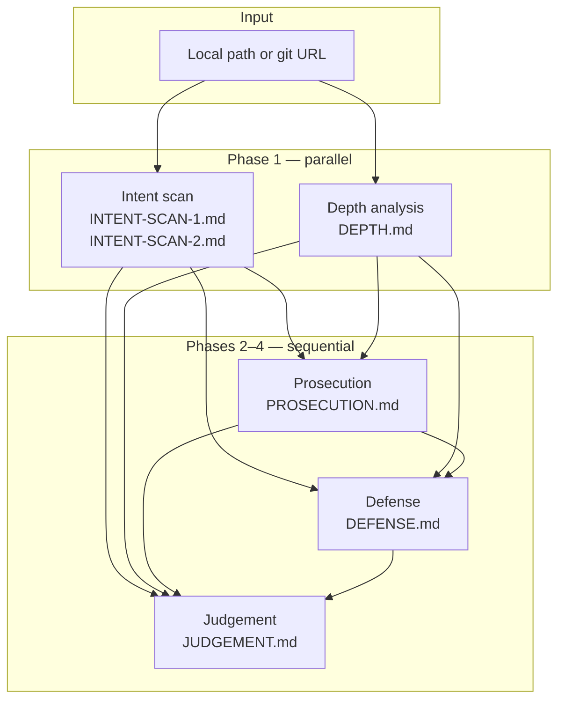

# middleton

*"is this legit?" Analysis Workflow

The name `middleton` comes from Judge Jeffery Middleton in St. Joseph County,
Michigan, who occasionally streams his courtroom. This project borrows the
trial format for reviewing repositories. Watch his
[YouTube channel](https://www.youtube.com/channel/UCS8gM5S889oBPyN6K07ZC6A/streams).

`middleton` is a Rust CLI that runs a structured, multi-phase review of a git
repository or local directory. It uses [OpenCode](https://opencode.ai),
[Claude Code](https://docs.anthropic.com/en/docs/claude-code), or
[Codex](https://github.com/openai/codex) agents to examine
source code alongside documentation and other project artifacts to produce a
trial-style
analysis: adversarial prosecution, charitable defense, and a middle-ground
legitimacy verdict.

Middleton examines whether a repository's claims are backed by working
implementation. The review looks for tangible engineering and identifies
unsupported claims or hollow scaffolding. It also considers how the project
presents itself and what that presentation suggests about its purpose.

Clanker generated code.

Published because people like seeing the results and want to run the process
with their own accounts. Live testing is limited. I would prefer a custom
agent, but wanted others to be able to use this workflow. Edit the prompts to
suit the material you are reviewing.

## Requirements

OpenCode is the default and best-tested backend. Codex and Claude Code have
less live testing.

- Rust toolchain (2024 edition; build with `cargo build --release`)
- One agent backend:
  - OpenCode (default): `opencode` on your `PATH` with OpenCode Go
    authentication configured through `opencode auth login`. Middleton uses
    the CLI's saved credentials; `OPENCODE_API_KEY` is an optional alternative.
  - Claude: `claude` on your `PATH` with authentication configured
  - Codex: `codex` on your `PATH` with Codex authentication configured
- PDF export (optional; `--skip-pdf` to skip): pandoc and xelatex
  (falls back to pdflatex). Body text uses DejaVu Sans for broad symbol
  coverage in agent-generated prose. On Ubuntu:

  ```bash
  sudo apt install pandoc texlive-xetex texlive-latex-recommended \
    texlive-latex-extra texlive-fonts-recommended fonts-dejavu fonts-lmodern
  ```

  Debian: see [`Dockerfile`](Dockerfile) (`runtime-base` apt/CTAN setup).
- eBook export (EPUB3) (optional; `--skip-epub` to skip): pandoc only (no
  TeX). `fonts-dejavu` is recommended so embedded typography matches the
  styled export. Independent of PDF — you can export EPUB without installing
  xelatex.

## How it works

Middleton runs five analysis phases against the target directory using either
OpenCode, Claude Code, or Codex. Each phase uses a plan → build workflow: the
agent plans its analysis, then writes structured markdown artifacts under
`<target>/.middleton/<agent>/<model>/<timestamp>/` (for example
`.middleton/opencode/kimi-k2-5/20250602-1430/`), so each run is isolated and
outcomes from different agent backends stay separate. Analysis is read-only
for the target corpus: the agent may use read-only git history and guarded web
search during the plan step only (when the backend supports it), then
transcribes findings during build. Middleton rejects installs, builds, tests, and
target-corpus writes; build steps may only write under the current run directory.

Session IDs are recorded in each run's `sessions.json`.



### Review profiles

Use `--profile` to choose the corpus lens (default `repository`):

| Profile | Use when |
|---------|----------|
| `repository` | Git repositories: assess implementation and supporting evidence against project claims |
| `documents` | Specs or design documents with little source code: evaluate their content without a missing-code penalty |

Both profiles run the same five phases and write the same artifact filenames.
`INTENT-SCAN-2` means full-codebase signals in `repository` mode and
cross-document structure/coherence in `documents` mode.

### Phases

| Phase | Reads | Writes | Role |
|-------|-------|--------|------|
| Intent | Corpus (read-only; scope depends on profile) | `INTENT-SCAN-1.md`, `INTENT-SCAN-2.md` | Examine rhetorical intent and how the project presents itself |
| Depth | Corpus (independent; ignores `.middleton/`) | `DEPTH.md` | Hollow vs. tangible substance (code/CI in `repository`; doc coherence in `documents`) |
| Prosecution | Intent scans + depth | `PROSECUTION.md` | Adversarial brief: psychological profiling, mythos, publishing intent |
| Defense | Intent scans + depth + prosecution | `DEFENSE.md` | Charitable rebuttal with the same structure as prosecution |
| Judgement | All prior artifacts | `JUDGEMENT.md` | Middle-ground synthesis and a committed legitimacy verdict |

## Install

```bash
cargo build --release
```

The binary is written to `target/release/middleton`.

## Docker

Docker images and `compose.yaml` are experimental. They are not built in CI
or tested manually against every agent platform. We don't hold accounts on
all backends and haven't paid to run full trials against each one.

Images bundle the `middleton` binary, pandoc/TeX for PDF export, pandoc/fonts
for EPUB3 export, and one agent backend per runtime target. See
[`Dockerfile`](Dockerfile) for build stages and [`compose.yaml`](compose.yaml)
for service definitions.

### Build

Plain `docker build` produces the OpenCode runtime (default target):

```bash
docker build -t middleton:opencode .
```

Other agent runtimes:

```bash
docker build --target codex-runtime -t middleton:codex .
docker build --target claude-runtime -t middleton:claude .
```

Overridable build args include `RUST_VERSION` (default `1.96.0`),
`DEBIAN_VERSION` (default `trixie`), `OPENCODE_VERSION` (default `v1.15.12`),
`CODEX_VERSION` (default `0.135.0`), and `CLAUDE_VERSION` (default `stable`).

### Compose

Three services map to the three runtime targets. The intended workflow is
`docker compose run`:

```bash
cp .env.opencode.token.example .env.opencode.token
# edit .env.opencode.token — set OPENCODE_API_KEY

docker compose run --rm middleton-opencode /workspace/my-repo
docker compose run --rm middleton-codex https://github.com/org/repo.git
docker compose run --rm middleton-claude /workspace/my-repo --model sonnet
```

Build args from the Dockerfile can be overridden in a root `.env` file (or the
shell environment) when running `docker compose build`:

| Variable | Default | Used by |
|----------|---------|---------|
| `RUST_VERSION` | `1.96.0` | all services |
| `DEBIAN_VERSION` | `trixie` | all services |
| `OPENCODE_VERSION` | `v1.15.12` | `middleton-opencode` |
| `CODEX_VERSION` | `0.135.0` | `middleton-codex` |
| `CLAUDE_VERSION` | `stable` | `middleton-claude` |

Token files (git-ignored):

| File | Variable |
|------|----------|
| `.env.opencode.token` | `OPENCODE_API_KEY` |
| `.env.codex.token` | `OPENAI_API_KEY` |
| `.env.claude.token` | `ANTHROPIC_API_KEY` |

Persistent storage defaults to the `middleton-data` named volume mounted at
`/workspace`. Override with a host path via `MIDDLETON_STORAGE` in a root
`.env` file (for example `MIDDLETON_STORAGE=./data`).

## Usage

Review a local directory with OpenCode:

```bash
middleton /path/to/repo
```

Review with Claude instead:

```bash
middleton /path/to/repo --agent claude --model sonnet
```

Review with Codex instead:

```bash
middleton /path/to/repo --agent codex
```

Review a specification or design document pack (no code penalty):

```bash
middleton /path/to/architecture-pack --profile documents
```

Clone and review a git repository (defaults to `./<repo-name>` in the current directory):

```bash
middleton https://github.com/org/some-repo.git --note "Fork submitted for an internal security review."
```

Clone to a specific directory:

```bash
middleton https://github.com/org/some-repo.git --output /tmp/some-repo
```

Export PDFs for an existing run directory, skipping files that already have a
matching `.pdf`:

```bash
middleton --export-pdf /path/to/repo/.middleton/opencode/kimi-k2-5/20250602-1430
```

Export EPUBs for an existing run directory, skipping files that already have a
matching `.epub`:

```bash
middleton --export-epub /path/to/repo/.middleton/opencode/kimi-k2-5/20250602-1430
```

Use one export-only option at a time, without a review input path or URL.

### Options

| Flag | Default | Description |
|------|---------|-------------|
| `--output`, `-o` | `./<repo-name>` | Clone destination when input is a git URL |
| `--agent` | `opencode` | Agent backend: `opencode`, `claude`, or `codex` |
| `--model` | `kimi-k2.5` | OpenCode Go catalog model id, `sonnet` / `opus` / `haiku` for Claude, or a Codex model id |
| `--reasoning-effort` | Codex configuration | Codex only: `none`, `minimal`, `low`, `medium`, `high`, `xhigh`, `max`, or `ultra`; availability depends on the selected model |
| `--hostname` | `127.0.0.1` | OpenCode server bind hostname |
| `--opencode` | `opencode` | Path to the OpenCode binary |
| `--claude` | `claude` | Path to the Claude binary |
| `--codex` | `codex` | Path to the Codex CLI binary |
| `--log-level` | `info` | Log filter (`RUST_LOG`-style; overridden by `RUST_LOG` if set) |
| `--pandoc` | `pandoc` | Pandoc binary used for PDF and EPUB export |
| `--skip-pdf` | — | Skip pandoc PDF export at the end |
| `--skip-epub` | — | Skip pandoc EPUB export at the end |
| `--export-pdf` | — | Export only markdown files in `DIR` that do not yet have a `.pdf` (skips the trial pipeline) |
| `--export-epub` | — | Export only markdown files in `DIR` that do not yet have a `.epub` (skips the trial pipeline) |
| `--note` | — | Private context hint prepended to all prompts (not citable as evidence) |
| `--profile` | `repository` | Corpus lens: `repository` or `documents` |

### Plan vs build and agent backends

During the plan step, agents may optionally use read-only `git` commands and
guarded web search/fetch to corroborate external claims; prompts require labeling
those findings as external context. During build, agents only write markdown
into the current run directory using the completed plan. They do not start
new investigations.

| Backend | `repository` plan step | `documents` plan step |
|---------|----------------------|----------------------|
| OpenCode | File reads + bash/git + web | File reads + web only |
| Claude | Reads + `Bash` + `WebSearch`/`WebFetch` | Reads + web tools; `Bash` disallowed |
| Codex | Network on; shell accepted in plan | Network on; shell declined in plan |

Build steps in both profiles allow file reads and `.middleton/` writes.
Shell commands and web access are disabled during build.

Middleton auto-answers tool permission prompts, user-input questions, and Codex
approval requests so Claude and Codex runs do not block waiting for a human
in the terminal.

Each run appends to `<target>/.middleton/<agent>/<model>/<timestamp>/actions.log`:
run timestamp, CLI options, target path, and every action middleton confirmed
on your behalf (also logged at `info` level).

If the target is a git repository and `.middleton/` is not listed in `.gitignore`,
middleton warns at the end of a successful run (it does not fail).

## Agent Specifics

### Codex

Middleton supports Codex through `codex app-server`. Install and
authenticate the Codex CLI before running:

```bash
middleton /path/to/repo --agent codex --skip-pdf --skip-epub
```

Without a Codex model override, Middleton uses the CLI's configured default
model. Pass `--model <model-id>` to select one, or `--codex /path/to/codex`
to use a specific executable. Use `--reasoning-effort max` to request maximum
reasoning on models that support it; omitting the flag preserves Codex's
configured effort. The override applies to every turn, including retries.
Plan turns investigate the corpus. Build turns write reports and retry missing
outputs up to the build-attempt limit.
See the [official app-server documentation](https://developers.openai.com/codex/app-server)
for the underlying protocol.

### OpenCode

Middleton uses the OpenCode Go provider (`opencode-go`). Pass a catalog
model id to `--model` (default `kimi-k2.5`), optionally prefixed with
`opencode-go/`. For example, `--model opencode-go/minimax-m3.1-flash` and
`--model minimax-m3.1-flash` select the same model.

OpenCode loads its saved provider credentials when Middleton starts it.
If authentication is not configured, run `opencode auth login` and select
OpenCode Go. Existing logins do not require `OPENCODE_API_KEY` to be exported.

To list models available on that provider:

```bash
opencode models opencode-go
```

This lists the OpenCode Go catalog. Running the following command instead
lists every configured provider:

```bash
opencode models
```

Choose the provider deliberately because billing differs between providers.

## Output

All artifacts are written to `<target>/.middleton/<agent>/<model-slug>/<yyyymmdd-hhmm>/`:

```text
.middleton/
└── opencode/              # or claude/, codex/, etc.
    └── kimi-k2-5/           # slugified --model value
        └── 20250602-1430/   # local run timestamp (no timezone suffix)
            ├── INTENT-SCAN-1.md    # Documentation-layer intent scan
            ├── INTENT-SCAN-2.md    # Codebase or cross-document intent scan
            ├── DEPTH.md            # Hollow vs. tangible substance analysis
            ├── PROSECUTION.md      # Adversarial brief (includes ## Pathos)
            ├── DEFENSE.md          # Charitable brief
            ├── JUDGEMENT.md        # Middle-ground legitimacy verdict
            ├── TRIAL.md            # Consolidated record (generated at end)
            ├── TRIAL.pdf           # Consolidated PDF (unless --skip-pdf)
            ├── TRIAL.epub          # Consolidated EPUB (unless --skip-epub)
            ├── sessions.json       # Session IDs per phase
            ├── actions.log         # Append-only audit log
            ├── context/
            │   └── reviewer-note.md  # Private --note text (when provided)
            └── ...
```

Prior runs remain under `.middleton/` in sibling timestamp directories. Agents are
instructed not to browse that tree; each run only reads its own phase artifacts.

When `--note` is provided, the note is saved privately under
`context/reviewer-note.md` and injected into prompts as a confidential context
hint for all parties. It may steer what gets a second look, but must not overtake
the review or dominate writeups. The corpus and prior phase artifacts remain
the primary evidence.
Public output must not cite the note itself or treat it as evidence.

After the pipeline completes, middleton writes `TRIAL.md` by merging the phase
reports in this order: Judgement, Prosecution, Defense, Depth, then any other
markdown artifacts (for example the intent scans). Each source file is kept;
`TRIAL.md` is an additional single-file outcome.

Unless `--skip-pdf` is set, middleton then runs pandoc on every phase `.md`
file and on `TRIAL.md`, writing matching `.pdf` files with numbered sections, a
table of contents, syntax highlighting, and a styled header/footer.

Unless `--skip-epub` is set, middleton runs pandoc on the same markdown files,
writing matching `.epub` files (EPUB3) with the same structure and middleton
branding. Export pre-processes agent markdown before pandoc: level-3+ headings are
flattened for clean PDF tables of contents; legacy `* **A)**` quiz-style bullets
are normalized to lettered lists; pandoc uses `markdown-raw_tex` so incidental
`\citep`-style LaTeX in agent prose is treated as literal text. The pandoc CLI
sets metadata (`title`, `author`, `lang`) for each export.

The target repository itself is not modified beyond the `.middleton/` tree.

## Contributing with coding agents

Start Codex from the repository root with `codex`. The root
[`AGENTS.md`](AGENTS.md) supplies the project map, build commands, tests,
and review rules. Codex reads this guidance automatically; see
[OpenAI's agent instructions guide](https://developers.openai.com/codex/guides/agents-md).
The same file is portable to other clients supporting the AGENTS.md standard.

Local checks match CI:

```bash
cargo fmt --all -- --check
cargo clippy --locked --all-targets --all-features -- -D warnings
cargo test --locked --all-targets --all-features
rumdl check README.md AGENTS.md
```

These checks do not need backend API keys. Generated `.middleton/` reports
are ignored by Git.

CI checks formatting and runs Clippy. Tests run on Linux and macOS, with a
separate check for the Rust version configured in `Dockerfile`.
Markdown linting pins rumdl to `0.2.62`.
The dependency audit runs on dependency changes and every Monday using
cargo-audit `0.22.1`, fetching current RustSec advisories. To run it locally:

```bash
cargo audit --deny warnings
```

## License

MIT; see [LICENSE](LICENSE).
